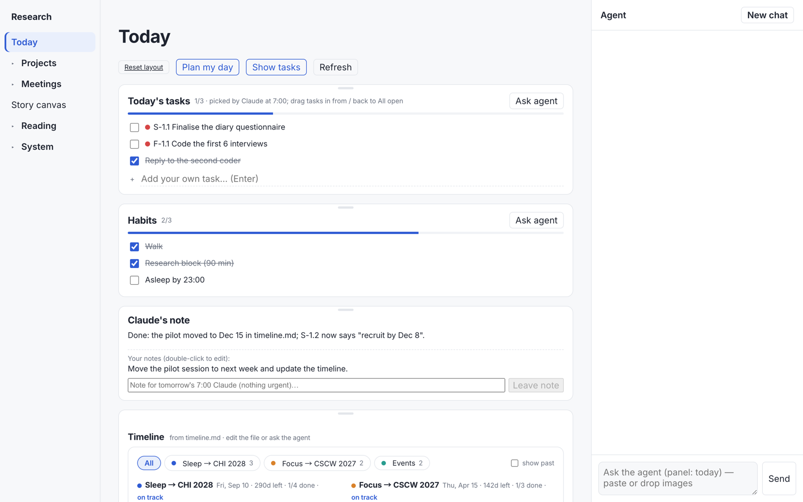
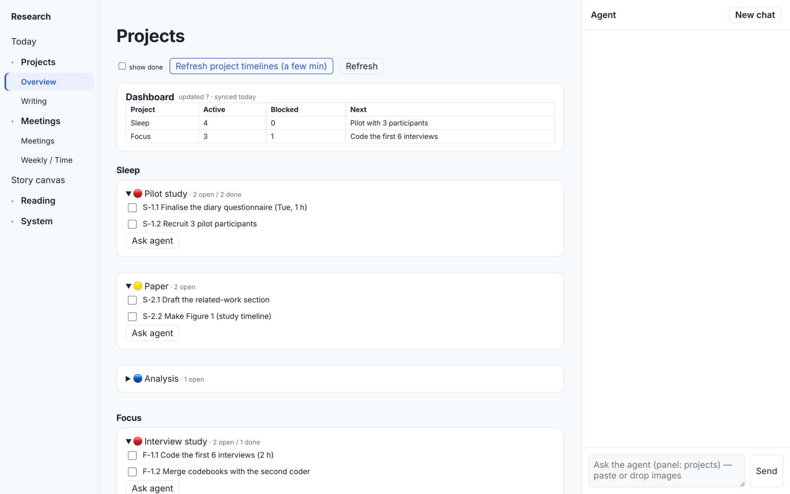
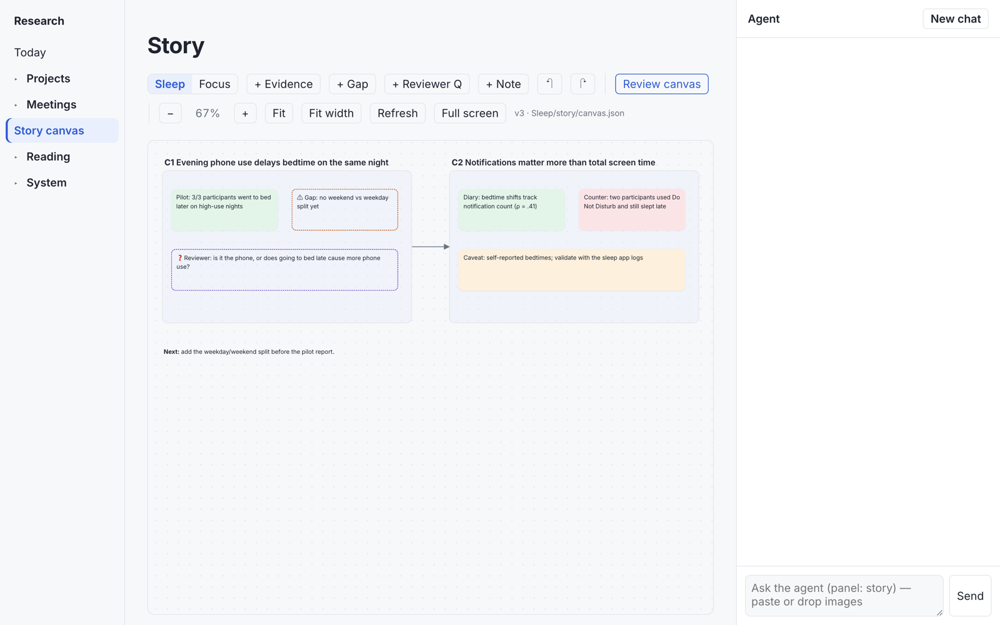
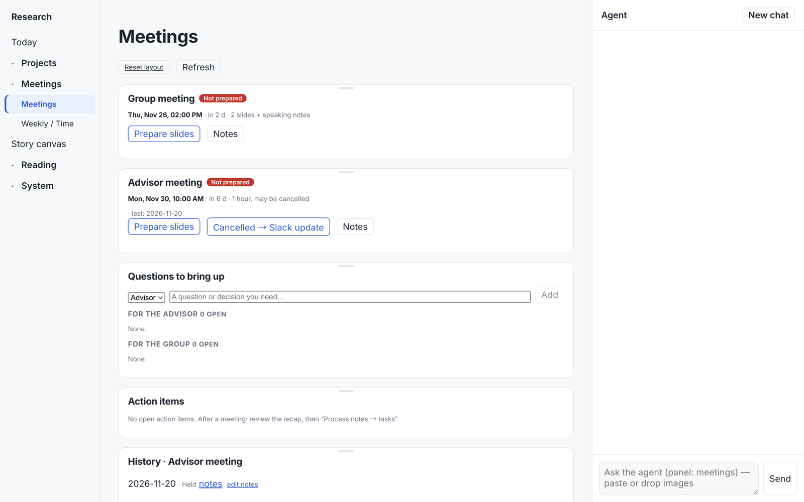

# Research Workbench

A self-hosted web workbench for one researcher (typically a PhD student) and a Claude Code agent that works
inside your research folder. Plain markdown files stay the source of truth; the web UI reads them, and the
agent edits them when you ask. Every agent change is journaled in git, so you can undo it from the chat.



| Projects | Story canvas | Meetings |
|---|---|---|
|  |  |  |

*Screenshots use a made-up demo workspace.*

## What you get

| Panel | Reads / writes | What it is for |
|---|---|---|
| **Today** | `research_tasks.md`, `daily_tracker.md` (optional) | Open 🔴 tasks, today's plan, notes to and from the agent |
| **Projects** | `research_tasks.md` | Dashboard, milestones and progress log per project |
| **Timeline** | `timeline.md` | Deadlines and backward-planned paper tracks |
| **Writing** | each project's `paper:` folder | Paper sections (LaTeX), word counts, a live PDF for a second screen |
| **Meetings** | `meetings/` | Advisor / group meeting prep, notes → recap → action items as tasks |
| **Story canvas** | `<project>/story/canvas.json` | An infinite board that links the paper's claims to evidence; drop in figures; the agent tags gaps and likely reviewer questions |
| **Reading** | `reading/`, Zotero (optional) | Reading list with an in-browser PDF reader, highlights and notes |
| **LitRadar / Trends** | `literature-radar/`, `trends/` | Weekly paper digests and a daily frontier feed (needs your own fetch jobs) |
| **Brain** | `reading_log/brain/brain.db`, Zotero (optional) | A 3D concept map of sources, highlights, concepts and questions: confirm or reject links, take notes, answer questions, ask AI about a node (Gemini, optional); new Zotero highlights flow in on Refresh |
| **Audiobooks** | `~/audiobooks` | PDF/EPUB books → TTS → a private podcast feed (optional) |
| **Agent** (every page) | the whole folder | Ask, paste screenshots, let it edit files; Undo per run |

## How your files are organised

Only three things are required; everything else is optional and appears when you use the panel that needs it.

```
Research/                       ← RP_RESEARCH_ROOT: your folder, not this repo
  projects.yaml                 ← required: your projects (see below)
  research_tasks.md             ← required: tasks per project
  timeline.md                   ← required: deadlines and milestones (may be empty)
  meetings/
    questions.md                  parking lot for the next meeting
    advisor/YYYY-MM-DD_{slides,notes,recap}.md
    group/...
  <Project>/
    0_SPINE.md                    one page: problem, approach, contributions
    1_NEXT.md                     at most 3 next actions
    paper/texfiles/*.tex          the draft (or point `paper:` elsewhere)
    data/raw/                     raw data — read-only for the agent (`data:` in projects.yaml)
    analysis/                     scripts and outputs
    story/canvas.json             Story canvas (created on first save), story/images/
```

`projects.yaml` maps the platform onto whatever layout you already have. **Nothing has to move**:

```yaml
projects:
  - name: Sleep            # id used in URLs and file names
    code: S                # task-ID prefix in research_tasks.md: S-1.2, S-MEET1120-1
    title: Sleep and screen time
    dir: Sleep             # project folder (default = name)
    paper: Sleep/paper     # optional: paper draft folder (texfiles/ inside)
    data: ~/studies/sleep  # optional: raw data, never modified
```

You do not have to write any of this by hand. Open the platform and tell the agent **"set up my workspace"**:
it lists your folders (without opening data files), proposes `projects.yaml`, and after you confirm creates only
what is missing. It never moves or renames your files. `example-workspace/` shows a complete small setup.

### daily_tracker.md (optional)

One `## YYYY-MM-DD (Day)` entry per day, newest first, with any of these sections (matched by keyword):

```markdown
## 2027-01-12 (Tue)

### Tasks
- [ ] 🔴 S-1.2 Draft the method section
- [ ] (add your own here)

### Habits
- [x] Walk

### Notes for Claude
> Move the pilot to next week.

### Claude reply
> Done: timeline.md updated.
```

## Quick start (your own computer)

Requirements: Python 3.12+, Node 20+, and [Claude Code](https://docs.anthropic.com/en/docs/claude-code) installed and
logged in (`claude` on your PATH).

```bash
git clone https://github.com/lyuyues/research-workbench.git && cd research-workbench
python3 -m venv .venv && .venv/bin/pip install -r requirements.txt
(cd frontend && npm ci && npm run build)

cp -R example-workspace ~/Research-demo          # or point at your real folder
export RP_RESEARCH_ROOT=~/Research-demo
export RP_GIT_DIR=~/.local/state/research-workbench/journal.git   # undo journal, outside your folder
export RP_STATIC_DIR=$PWD/frontend/dist
export RP_ALLOWED_ORIGIN=http://127.0.0.1:8000
.venv/bin/uvicorn backend.main:app --host 127.0.0.1 --port 8000
```

Open http://127.0.0.1:8000. Without an access header the app treats the local user as the owner, so **only bind
it to 127.0.0.1** on your own machine.

## Running it on a server

The agent runs with full permissions inside your research folder (`claude -p --permission-mode bypassPermissions`).
Never expose the app to the internet without authentication in front of it. `deploy/README.md` describes the
setup this project was built on: a small Linux server, systemd, and Cloudflare Tunnel + Cloudflare Access
(`RP_REQUIRE_ACCESS=1` makes the app reject every request without a valid Access token).

## Privacy

Your research folder is never part of this repository. The agent is told to treat `data:` folders as read-only
and not to copy participant-identifying details into other files, but it is an AI agent with file access: keep
identifiable raw data outside the Research folder if your ethics approval requires it, and review its changes
(each run lists the files it changed, with Undo).

## Customising the agent

`backend/hints.py` is what the agent is told about your workspace and each panel. Add your own conventions and
shortcuts there (for example "when I say 'weekly update', write …").

## Status

This is the public edition of a personal platform, published as is. Issues and pull requests are welcome.

## License

MIT, see [LICENSE](LICENSE).
